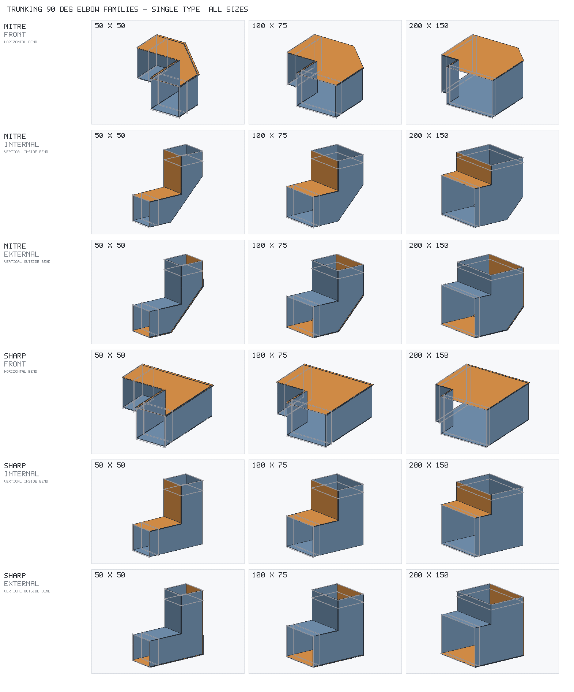

# Revit 電纜線槽 90° 彎頭族產生器

用程式產生六個**參數化**的 Revit 電纜線槽彎頭族。每個族檔只有 **一個類型**（`Standard`），
靠實例參數 + 公式 + 帶標籤的草圖尺寸，就能涵蓋 50×50 到 300×100 之間**任意** W×H，
可直接掛進 Revit 的 Cable Tray **Routing Preferences**。

| # | 族檔 | 彎頭型式 | Routing Preferences 槽位 |
|---|---|---|---|
| 1 | `Trunking_90_MitreBend_FrontOpening.rfa` | 斜角 45° 斜切（mitre）| Horizontal Bend |
| 2 | `Trunking_90_MitreBend_InternalOpening.rfa` | mitre | Vertical Inside Bend |
| 3 | `Trunking_90_MitreBend_ExternalOpening.rfa` | mitre | Vertical Outside Bend |
| 4 | `Trunking_90_SharpBend_FrontOpening.rfa` | 死角 90°（sharp）| Horizontal Bend |
| 5 | `Trunking_90_SharpBend_InternalOpening.rfa` | sharp | Vertical Inside Bend |
| 6 | `Trunking_90_SharpBend_ExternalOpening.rfa` | sharp | Vertical Outside Bend |

規格來源：廠商型錄 `Trunking21 - 25v2_09.jpg`（第 8 頁，電線槽曲及配件）。



## 快速開始

```bash
make test                      # 64 個單元測試（含建置流程、伸縮驗證）
make verify                    # 6 族 × 41 項驗收檢查 × 11 種尺寸
make preview                   # 產生 docs/preview/*.png
make dry-run                   # 用假 Revit 文件跑完整建置流程
```

在 Revit 內（pyRevit / RevitPythonShell）：

```bash
python build_families.py --out C:\BIM\Trunking --template "<...>\Metric Cable Tray Fitting.rft"
python verify_families.py --families C:\BIM\Trunking     # 在 Revit 裡量測實體幾何
```

## 這個 repo 的稽核結果（先查再寫）

工作區原本**只有一個 `README.md`（內容是一行 `# revit`）**，沒有任何 Revit 專案、`.csproj`、
Add-in manifest、樣板路徑設定或建置腳本可沿用：

* 沒有既有的 C# / .NET 專案可參考 → 沒有「既有 API 專案結構」可繼承。
* 沒有 template 路徑設定 → 以 `find_template()` 依 `RVT 2026 → 2020` 搜尋
  `C:\ProgramData\Autodesk\...`、`C:\Program Files\Autodesk\...`（英/中文版皆可），
  並支援 `--template` 與 `TRUNKING_TEMPLATE` 覆寫。
* 沒有既有的建置/測試方式 → 本 repo 建立並記錄新慣例（見下）。

因此下列慣例是**新訂**的，不是繼承來的：

| 項目 | 決定 |
|---|---|
| 目標版本 | Revit 2024（API 以 `_probe` 兼容 2020–2026；`AddParameter` 同時支援 `ForgeTypeId` 與舊 `ParameterType`）|
| 樣板 | `Metric Cable Tray Fitting.rft` |
| 語言 | Python 3.10+，只用**標準函式庫**（沙盒無 .NET SDK / Mono，無法編譯 C#） |
| 測試 | `unittest`，`python3 -m unittest discover -s python/tests -t python` |
| 文件 | 中英混合，數值一律標明單位 |

## 架構

```
python/
├── trunking/
│   ├── spec.py        型錄資料（9 個尺寸）、六個族的靜態定義、型號代碼
│   ├── expr.py        Revit 公式子集的剖析/求值（含 if/and/round/sqrt、單位）
│   ├── lin.py         精確仿射式 (Lin = k + Σ cᵢ·paramᵢ)，用來做尺寸匹配
│   ├── geometry.py    2D/3D 幾何核：外形輪廓、鏈條條帶、Frame、棱柱體積/水密性
│   ├── model.py       build_model(kind, wall_variant) → 參數表 + 實體 + 接頭 + 符號線
│   ├── evaluate.py    把模型「伸縮」到某個 W×H 並求值（面積、體積、接頭）
│   ├── dimplan.py     自動推導「哪條邊標哪個參數」的尺寸計畫（DimPlan）
│   ├── verify.py      41 項驗收檢查 × 11 種尺寸
│   ├── adapter.py     Revit 介面契約（一個方法對應一個 Revit 呼叫）
│   ├── builder.py     8 步建置流程（樣板→單一類型→參數→實體→尺寸→接頭→零件類型→存檔）
│   ├── fake_revit.py  記憶體假文件（可在無 Revit 環境完整跑建置流程）
│   ├── revit_api.py   真正的 Revit API 實作（每步皆有 _probe 降級）
│   ├── report.py      Markdown 報告產生（參數表、實體驗證、能力矩陣）
│   └── pncanvas.py    無依賴的點陣圖 + PNG 輸出（預覽圖用）
├── build_families.py  CLI：建置六個族（Revit 內）或 --dry-run
├── verify_families.py CLI：--model-only（任何環境）/ --families（Revit 內實測）
└── preview.py         CLI：輸出 8 張預覽圖
```

**單一類型是硬性契約**：`build_model` 的 `FamilyModel.type_names` 只有 `("Standard",)`，
`builder` 用 `RenameCurrentType` 而不是 `NewType()`，存檔前斷言 `FamilyManager.Types.Size == 1`，
`fake_revit` 會拒絕任何第二個類型，測試 `test_exactly_one_type_and_new_type_never_called` 驗證
`NewType()` 從未被呼叫。

## 尺寸與公式

```
A = B = W + 75            正面（水平）彎：CenterToEnd = W/2 + 75
D = E = H + 75            內開/外開（垂直）彎：CenterToEnd = H/2 + 75
C_mitre = 75·√2 ≈ 106     C_sharp = 75
WallThickness            if(and(Width<=50,Height<=50), 1, 1.2~1.6 mm)  ← 見 docs/02
```

驗收矩陣（節錄，完整見 `docs/04-verification-report.md`）：

| W×H | A/B | C mitre | C sharp | T |
|---|---|---|---|---|
| 50×50 | 125 | 106.07 | 75 | T10 |
| 100×100 | 175 | 106.07 | 75 | T12 / T14 ⚠️ |
| 200×200 | 275 | 106.07 | 75 | T16 |
| 300×100 | 375 | 106.07 | 75 | 非標準 |
| 50×100 | 125 | 106.07 | 75 | 非標準 |

⚠️ 100×100（及 150×150）的板厚在「委託公式」與「圖紙型號」之間有差異，兩種都提供，
詳見 [`docs/02-walls.md`](docs/02-walls.md)。

## 文件

| 文件 | 內容 |
|---|---|
| [`docs/01-spec.md`](docs/01-spec.md) | 型錄抄錄、公式推導、2D/3D 建構、尺寸計畫、蓋板方位規則 |
| [`docs/02-walls.md`](docs/02-walls.md) | 板厚公式的兩個變體與切換方式 |
| [`docs/03-manual-labelling.md`](docs/03-manual-labelling.md) | 自動產生的尺寸標註表（API 降級時人工補做用） |
| [`docs/04-verification-report.md`](docs/04-verification-report.md) | 6 族 × 41 檢查 × 11 尺寸的驗證報告 |
| [`docs/05-build-report.md`](docs/05-build-report.md) | 建置能力矩陣（每步 OK/FALLBACK/SKIPPED） |
| [`docs/07-routing-preferences.md`](docs/07-routing-preferences.md) | 部署、Routing Preferences 設定、LOD、檢查清單 |

## 已知限制

1. **沙盒沒有 .NET SDK / 也無法執行 Revit**，所以本 repo 不含已編譯的 Add-in，也不含實體 `.rfa`：
   真正的 `.rfa` 由 `build_families.py` 在 Revit 內產生。程式的正確性由「模型 + 假 Revit 文件」
   的 64 個測試與 246 項驗收檢查保證；API 層（`revit_api.py`）以 `_probe` 兼容不同版本，
   失敗時降級並列出人工步驟，不會產生半成品族檔。
2. **草圖尺寸的 API 支援依版本而異**：若 `SketchEditScope`/`Dimension.FamilyLabel` 不被允許，
   建置會標記 `FALLBACK` 並輸出 `docs/03-manual-labelling.md`（每族約 37–43 條），在族編輯器內
   照表標註即可，參數與公式都已經建好。
3. 原始委託訊息在第五節（尺寸表）被截斷，型錄的 C 欄四捨五入為 106，程式用精確值 106.07；
   Revit 沒有 `sqrt()` 函數，故 `C = Mitre_Leg * 1.41421356`（相對誤差 < 1e-8）。
